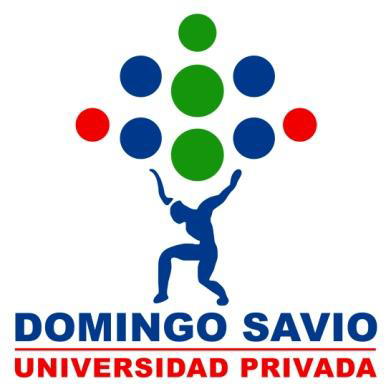

<div align="center">



<br />

# 🚌 RutaOptima

### Optimizador de Rutas del Transporte Público de La Paz

**Proyecto Final Integrador 2 · Estructura de Datos**  
**Universidad Privada Domingo Savio (UPDS) · Gestión 2026**

*Una aplicación académica de consola para analizar caminos, distancias y cambios de línea utilizando grafos.*

</div>

---

## Datos del proyecto

| Campo | Información |
|:---|:---|
| Universidad | Universidad Privada Domingo Savio (UPDS) |
| Carrera | Ingeniería de Sistemas |
| Asignatura | Estructura de Datos — 5.º semestre |
| Autor | Carlos Alberto Alvarado Ramos |
| Docente | Msc. Lic. Andrés Grover Albino Chambi |
| Proyecto | Proyecto Final Integrador |
| Modalidad | Desarrollo individual |
| Lenguaje y plataforma | C# — .NET 10 |
| Entorno de desarrollo | Visual Studio 2026 |
| Control de versiones | Git y GitHub |
| Contexto | Transporte público de La Paz, Bolivia |

---

## Índice

1. [Introducción](#1-introducción)
2. [Problemática y justificación](#2-problemática-y-justificación)
3. [Objetivos](#3-objetivos)
4. [Marco teórico](#4-marco-teórico)
5. [Diseño y arquitectura del sistema](#5-diseño-y-arquitectura-del-sistema)
6. [Funcionalidades implementadas](#6-funcionalidades-implementadas)
7. [Instalación y ejecución](#7-instalación-y-ejecución)
8. [Pruebas y resultados](#8-pruebas-y-resultados)
9. [Evidencias visuales](#9-evidencias-visuales)
10. [Limitaciones y mejoras futuras](#10-limitaciones-y-mejoras-futuras)
11. [Conclusiones](#11-conclusiones)
12. [Aporte social y ODS 11](#12-aporte-social-y-ods-11)
13. [Control de versiones](#13-control-de-versiones)

---

## 1. Introducción

RutaOptima es una aplicación de consola desarrollada en C# como parte de la asignatura **Estructura de Datos**. Su propósito es representar una red de transporte mediante un **grafo ponderado**, en el que las paradas o estaciones son los vértices y las conexiones entre ellas son las aristas.

El sistema permite registrar paradas de bus, PumaKatari y teleférico, construir conexiones, consultar recorridos, calcular distancias y explorar alternativas de viaje con distintos criterios.

Se trata de un **prototipo académico**. Los nombres genéricos, las líneas y las distancias utilizadas en las pruebas son ilustrativos y no constituyen información oficial ni actualizada del transporte paceño.

## 2. Problemática y justificación

### 2.1 Problemática

En una red de transporte urbano pueden existir varios caminos entre dos puntos. Cada recorrido puede presentar una cantidad diferente de conexiones, distancia recorrida o cambios entre líneas de transporte. Comparar manualmente estas alternativas resulta difícil cuando la red crece.

### 2.2 Justificación

Los grafos y sus algoritmos permiten modelar formalmente estas relaciones. RutaOptima aplica los conocimientos de arreglos, nodos, listas enlazadas, pilas, colas, recursividad y árboles para demostrar cómo se pueden descubrir caminos y evaluar alternativas de desplazamiento.

### 2.3 Alcance

La aplicación trabaja mediante un menú de consola, registra información en memoria y permite analizar redes de prueba. No incluye mapas geográficos, horarios, tarifas ni una base de datos permanente.

## 3. Objetivos

### 3.1 Objetivo general

Desarrollar una aplicación en C# que modele una red de transporte público mediante grafos y permita explorar y comparar rutas utilizando estructuras de datos y algoritmos de búsqueda.

### 3.2 Objetivos específicos

- Registrar paradas y estaciones junto con su tipo de transporte.
- Crear conexiones entre paradas, indicando línea y distancia en kilómetros.
- Representar la red mediante listas de adyacencia enlazadas.
- Aplicar BFS, DFS recursivo, DFS iterativo y Dijkstra.
- Calcular recorridos con un número mínimo de cambios de línea.
- Construir un árbol de expansión desde una parada de origen.
- Identificar paradas aisladas o con pocas conexiones.
- Validar entradas y evitar identificadores y conexiones duplicadas.
- Documentar el desarrollo mediante Git y GitHub.

## 4. Marco teórico

| Concepto | Aplicación en RutaOptima |
|:---|:---|
| **Arreglo** | Almacena las paradas y datos auxiliares de búsqueda. |
| **Nodo genérico** | Contiene un dato y la referencia al siguiente nodo. |
| **Lista simplemente enlazada** | Almacena las conexiones de cada parada. |
| **Grafo ponderado** | Representa paradas como vértices y conexiones como aristas con distancia. |
| **Cola (FIFO)** | Atiende primero el elemento ingresado primero; se utiliza en BFS. |
| **Pila (LIFO)** | Retira primero el último elemento ingresado; se utiliza en DFS iterativo. |
| **Recursividad** | Permite explorar rutas mediante DFS recursivo. |
| **Árbol** | Representa la expansión desde una raíz sin repetir vértices ni crear ciclos. |
| **Cola de prioridad** | Permite seleccionar el estado con menor costo conocido. |

### 4.1 Algoritmos de búsqueda

**BFS (búsqueda en anchura):** explora la red por niveles utilizando una cola enlazada. Su resultado minimiza la **cantidad de conexiones**, no necesariamente la distancia ni los transbordos.

**DFS (búsqueda en profundidad):** explora caminos siguiendo las conexiones disponibles. RutaOptima incorpora una versión recursiva para enumerar caminos simples y una versión iterativa basada en una pila enlazada.

**Dijkstra:** calcula la ruta de **menor distancia acumulada** a partir de los kilómetros asignados a las conexiones, con pesos no negativos.

**Búsqueda con menos transbordos:** considera tanto la parada actual como la línea utilizada. Da prioridad al menor número de cambios de línea y, en caso de empate, a menos conexiones. Se implementa mediante una cola de prioridad; es una búsqueda distinta del BFS tradicional.

## 5. Diseño y arquitectura del sistema

### 5.1 Modelo de la red

- **Vértices:** objetos `Parada`, con identificador, nombre y tipo.
- **Aristas:** objetos `Conexion`, con destino, distancia y línea.
- **Lista de adyacencia:** cada parada mantiene sus conexiones en una `ListaSimple<Conexion>`.
- **Peso:** distancia de la conexión expresada en kilómetros.

### 5.2 Organización de archivos

```text
RutaOptima-UPDS/
├── README.md
├── RutaOptima.slnx
└── RutaOptima/
    ├── RutaOptima.csproj
    ├── Program.cs
    ├── MenuConsola.cs
    ├── Parada.cs
    ├── Conexion.cs
    ├── Nodo.cs
    ├── ListaSimple.cs
    ├── ColaConNodos.cs
    ├── PilaConNodos.cs
    ├── NodoArbol.cs
    └── GrafoTransporte.cs
```

### 5.3 Responsabilidad de los componentes

| Archivo | Función principal |
|:---|:---|
| `Program.cs` | Inicia el menú y conserva pruebas desarrolladas durante la implementación. |
| `MenuConsola.cs` | Presenta las opciones y lee las entradas del usuario. |
| `Parada.cs` | Define los datos de una parada. |
| `Conexion.cs` | Define una conexión ponderada entre paradas. |
| `Nodo.cs` y `ListaSimple.cs` | Construyen las listas enlazadas utilizadas en el proyecto. |
| `ColaConNodos.cs` | Implementa una cola mediante nodos. |
| `PilaConNodos.cs` | Implementa una pila mediante nodos. |
| `NodoArbol.cs` | Representa los nodos del árbol de expansión. |
| `GrafoTransporte.cs` | Administra la red, la conectividad y los algoritmos de rutas. |

## 6. Funcionalidades implementadas

El menú interactivo presenta las siguientes opciones:

| Opción | Funcionalidad |
|:---:|:---|
| 1 | Registrar nueva parada |
| 2 | Registrar conexión |
| 3 | Mostrar paradas y conexiones |
| 4 | Buscar ruta con BFS (menos conexiones) |
| 5 | Explorar rutas con DFS |
| 6 | Calcular ruta mínima con Dijkstra |
| 7 | Mostrar árbol de expansión |
| 8 | Mostrar reporte de conectividad |
| 9 | Buscar ruta con menos transbordos |
| 0 | Salir |

También incorpora validación de entradas numéricas y distancias positivas, control de identificadores repetidos y rechazo de conexiones duplicadas por destino y línea.

## 7. Instalación y ejecución

### Requisitos

- Windows con **Visual Studio 2026** y soporte para C#.
- **.NET SDK 10**, correspondiente al proyecto `net10.0`.
- Git (opcional para clonar y consultar el historial).

### Desde Visual Studio

1. Descargar o clonar este repositorio.
2. Abrir `RutaOptima.slnx`.
3. Seleccionar el proyecto **RutaOptima** como proyecto de inicio.
4. Ejecutar con **Ctrl + F5**.
5. Seleccionar una opción del menú e introducir los identificadores solicitados.

### Desde la terminal

```bash
git clone https://github.com/Carlos-Sistemas-UPDS/RutaOptima-UPDS.git
cd RutaOptima-UPDS
dotnet run --project RutaOptima/RutaOptima.csproj
```

**Nota:** las nuevas paradas o conexiones agregadas durante la sesión se conservan en memoria. Al cerrar y ejecutar nuevamente el programa se cargan los datos iniciales de demostración.

## 8. Pruebas y resultados

### 8.1 Comparación de BFS, DFS y Dijkstra

En una red ficticia se registraron estas conexiones:

| Origen | Destino | Distancia | Línea |
|:---|:---|---:|:---|
| Parada A | Parada B | 2,5 km | Línea de prueba |
| Parada B | Estación C | 1,2 km | Línea de prueba |
| Parada A | Estación C | 9 km | Línea directa |

**Resultados observados en las pruebas de consola:**

| Algoritmo | Ruta encontrada | Interpretación |
|:---|:---|:---|
| BFS | A → C | 1 conexión; minimiza tramos. |
| DFS recursivo | A → B → C y A → C | Explora dos caminos simples. |
| Dijkstra | A → B → C | 3,7 km; minimiza distancia. |

### 8.2 Menos transbordos

En otra red de prueba se compararon dos alternativas. Una usaba dos conexiones con un cambio de línea y otra utilizaba tres conexiones sin cambiar de línea. El método de menos transbordos seleccionó el segundo recorrido, **A → B → C → E**, con **0 transbordos**.

### 8.3 Árbol y conectividad

Se comprobó la construcción de un árbol desde una parada de origen. El reporte identificó correctamente paradas con cero, una o varias conexiones, y actualizó sus resultados después de registrar nuevas aristas.

### 8.4 Validaciones

Se probaron entradas no numéricas, distancias negativas, identificadores repetidos y conexiones duplicadas. El sistema rechazó los valores incorrectos en los escenarios ensayados.

## 9. Evidencias visuales

Se reservaron los siguientes espacios para añadir **capturas reales de Visual Studio y de la consola**, obtenidas durante la ejecución del proyecto:

| Evidencia | Descripción |
|:---|:---|
| Captura 1 | Menú principal con sus opciones. |
| Captura 2 | Comparación de los resultados BFS, DFS y Dijkstra. |
| Captura 3 | Árbol de expansión y reporte de conectividad. |
| Captura 4 | Cálculo de transbordos y validaciones. |

> Para incluir las imágenes antes de la entrega, crea una carpeta `docs/capturas/` y agrega allí archivos PNG. Luego añade enlaces Markdown del tipo `` en esta sección. No se muestran imágenes inexistentes.

## 10. Limitaciones y mejoras futuras

- La red inicial y sus distancias son ilustrativas: no se usan datos oficiales de transporte en tiempo real.
- Los registros creados durante la sesión no se almacenan de forma permanente.
- El cálculo de Dijkstra minimiza **kilómetros**, no tiempos reales de viaje.
- El árbol de expansión refleja la exploración del grafo, pero **no es** un árbol de expansión mínima ponderado.
- La enumeración de caminos con DFS se ha probado en redes pequeñas; en redes grandes puede producir muchos resultados.
- Como mejora futura pueden incorporarse almacenamiento persistente, información geográfica, tiempos, tarifas, historial de consultas y visualización en mapas.

## 11. Conclusiones

RutaOptima permitió aplicar de manera integrada conceptos de Estructura de Datos: arreglos, nodos, listas enlazadas, colas, pilas, recursividad, grafos y árboles.

Las pruebas demostraron que **los algoritmos resuelven problemas diferentes**: BFS minimiza conexiones, DFS explora caminos, Dijkstra minimiza la distancia acumulada y el algoritmo adicional de transbordos minimiza cambios de línea.

El desarrollo incremental y los commits convencionales facilitaron la comprobación de cada funcionalidad antes de integrarla al menú de consola.

## 12. Aporte social y ODS 11

El proyecto se relaciona con el **ODS 11 — Ciudades y Comunidades Sostenibles**, porque explora cómo el análisis de redes puede contribuir a la planificación de alternativas de movilidad urbana.

Como proyección emprendedora, una versión ampliada podría integrar datos verificables de operadores de transporte, horarios y geolocalización para apoyar a usuarios y planificadores urbanos en La Paz.

## 13. Control de versiones

Este proyecto se desarrolló de forma individual con Git y GitHub. Las funcionalidades y correcciones se registraron progresivamente mediante commits convencionales como `feat:`, `fix:` y `docs:`.

**Repositorio:** [Carlos-Sistemas-UPDS/RutaOptima-UPDS](https://github.com/Carlos-Sistemas-UPDS/RutaOptima-UPDS)

---

<div align="center">

**Universidad Privada Domingo Savio · Ingeniería de Sistemas**  
**Proyecto Final Integrador — Estructura de Datos · 2026**

</div>
