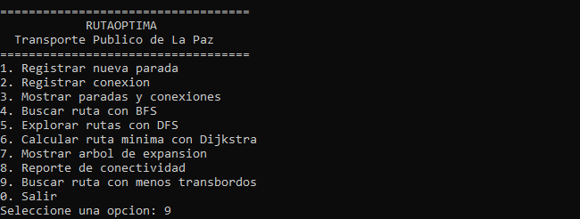
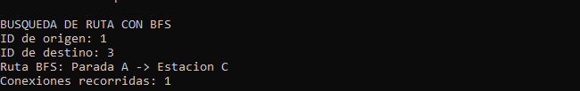
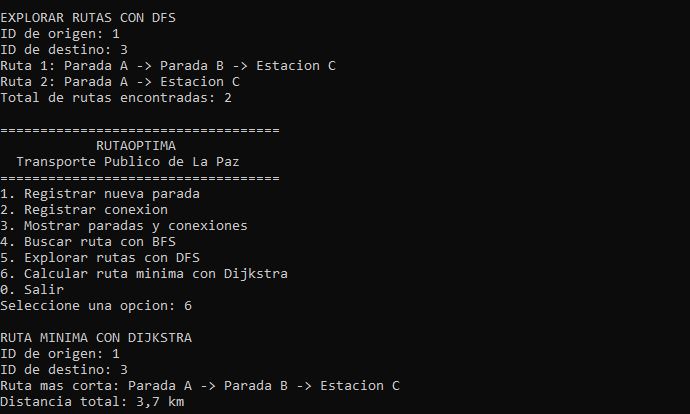
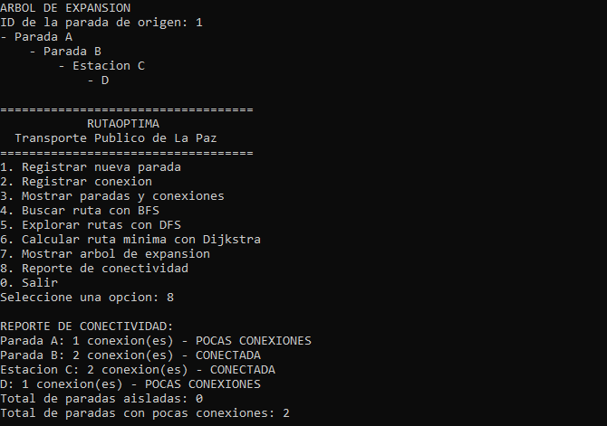
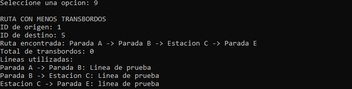
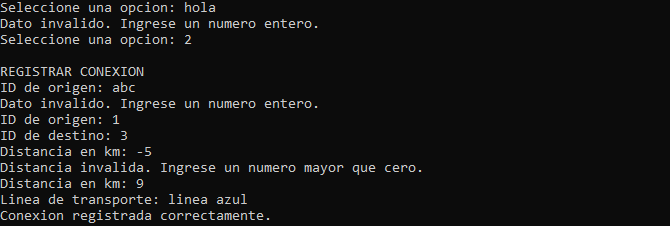

<div align="center">


<br />

# 🚌 RutaOptima

### Optimizador de Rutas del Transporte Público de La Paz

**Proyecto Final Integrador · Estructura de Datos**  
**Universidad Privada Domingo Savio (UPDS — La Paz) · Gestión 2026**

*Una aplicación académica de consola para analizar caminos, distancias y cambios de línea utilizando grafos.*

</div>

---

## Datos del proyecto

| Campo | Información |
|:---|:---|
| Universidad | Universidad Privada Domingo Savio (UPDS) |
| Carrera | Ingeniería de Sistemas |
| Asignatura | Estructura de Datos — 5to Semestre |
| Autor | Carlos Alberto Alvarado Ramos |
| Docente | Msc. Lic. Andrés Grover Albino Chambi |
| Proyecto | Proyecto Final Integrador |
| Modalidad | Desarrollo individual |
| Lenguaje y plataforma | C# — .NET 10 |
| Entorno de desarrollo | Visual Studio 2026 |
| Control de versiones | Git y GitHub |
| Contexto | Transporte público de La Paz, Bolivia |

---

## Índice

1. [Introducción](#1-introducción)
2. [Problemática y justificación](#2-problemática-y-justificación)
3. [Objetivos](#3-objetivos)
4. [Marco teórico](#4-marco-teórico)
5. [Diseño y arquitectura del sistema](#5-diseño-y-arquitectura-del-sistema)
6. [Funcionalidades implementadas](#6-funcionalidades-implementadas)
7. [Instalación y ejecución](#7-instalación-y-ejecución)
8. [Pruebas y resultados](#8-pruebas-y-resultados)
9. [Evidencias visuales](#9-evidencias-visuales)
10. [Limitaciones del sistema](#10-limitaciones-del-sistema)
11. [Conclusiones y recomendaciones](#11-conclusiones-y-recomendaciones)
12. [Aporte social y ODS 11](#12-aporte-social-y-ods-11)

---

## 1. Introducción

RutaOptima es una aplicación académica de consola desarrollada en **C# con .NET 10** para el Proyecto Final Integrador de **Estructura de Datos**. Representa una red de transporte público como un **grafo ponderado**: las paradas o estaciones son los vértices y las conexiones entre ellas son las aristas, cada una con una distancia y una línea de transporte asociadas.

El programa permite registrar paradas y conexiones desde un menú, recorrer la red con BFS y DFS, hallar un camino de menor distancia con Dijkstra, encontrar alternativas con menos cambios de línea, construir un árbol de expansión y examinar la conectividad. Cada funcionalidad fue desarrollada por etapas y comprobada mediante ejecuciones de consola.

> **Naturaleza del proyecto:** es un **prototipo educativo** para demostrar estructuras de datos y algoritmos. Los nombres genéricos, las líneas y las distancias de sus ejemplos son **ficticios**; no ofrece rutas, horarios ni distancias oficiales de La Paz.

## 2. Problemática y justificación

### 2.1 Contexto y problemática

La movilidad urbana de La Paz combina distintas modalidades de transporte, como buses, el sistema PumaKatari y el teleférico. Al representar conexiones entre paradas aparecen decisiones diferentes: una ruta puede usar menos tramos, otra puede recorrer menos kilómetros y una tercera requerir menos cambios de línea.

En una red con varias alternativas, identificar manualmente esos recorridos se vuelve más difícil. La cuestión que aborda RutaOptima es **cómo almacenar las relaciones entre paradas y consultar rutas según criterios diferentes**.

### 2.2 Justificación técnica

Un grafo permite expresar formalmente el problema: cada parada es un vértice, y cada conexión es una arista. Sobre esa representación se pueden aplicar algoritmos de búsqueda y optimización. El desarrollo también permite demostrar el uso conjunto de arreglos, memoria dinámica, nodos, listas enlazadas, colas, pilas, recursividad y árboles, contenidos de la materia.

### 2.3 Alcance

RutaOptima funciona de forma **local, mediante una consola**. Permite modificar la red mientras está abierta, consultar caminos y observar resultados de prueba. No incluye base de datos, mapas, geolocalización, tarifas, frecuencias, horarios ni información de tráfico en tiempo real.

## 3. Objetivos

### 3.1 Objetivo general

Desarrollar en C# un sistema de consola que represente una red de transporte mediante un grafo ponderado y permita explorar y comparar rutas aplicando estructuras de datos y algoritmos de búsqueda.

### 3.2 Objetivos específicos

- Registrar paradas con identificador, nombre y tipo de transporte.
- Registrar conexiones entre paradas con línea y distancia positiva.
- Construir una representación del grafo con **listas de adyacencia enlazadas**.
- Aplicar **BFS** para buscar un camino de menor número de conexiones.
- Aplicar **DFS recursivo** para enumerar caminos simples y **DFS iterativo** mediante una pila.
- Calcular rutas de **menor distancia** mediante **Dijkstra**.
- Buscar recorridos con **menos cambios de línea**, distinguiéndolos del número de conexiones.
- Construir un árbol de expansión a partir de una parada alcanzable.
- Clasificar paradas aisladas o con pocas conexiones.
- Validar entradas y evitar identificadores o conexiones duplicadas.
- Documentar resultados, limitaciones y avances mediante Git y GitHub.

## 4. Marco teórico

### 4.1 Estructuras fundamentales

| Concepto | Definición sencilla | Uso en RutaOptima |
|:---|:---|:---|
| **Arreglo** | Conjunto de posiciones accesibles por índice. | Guarda las paradas y los arreglos auxiliares `visitados`, `padres` y `distancias`. |
| **Memoria dinámica** | Creación de objetos mientras se ejecuta el programa. | Permite crear nuevos objetos `Parada`, `Nodo<T>`, `Conexion` y `NodoArbol<T>`. |
| **Nodo genérico** | Objeto que guarda un dato y un enlace hacia otro nodo. | Constituye la base de las listas, pilas y colas propias. |
| **Lista simplemente enlazada** | Secuencia de nodos conectados mediante referencias. | Almacena las conexiones que salen de cada parada. |
| **Cola (FIFO)** | El primero que entra es el primero que sale. | Soporta el recorrido BFS por niveles. |
| **Pila (LIFO)** | El último que entra es el primero que sale. | Soporta la versión iterativa de DFS. |
| **Recursividad** | Un método se llama a sí mismo en una subexploración. | Se utiliza en DFS recursivo y al mostrar el árbol. |
| **Grafo ponderado** | Conjunto de vértices y aristas con valores asociados. | Modela paradas, conexiones, distancias y líneas. |
| **Árbol** | Estructura jerárquica que no contiene ciclos. | Presenta los descubrimientos desde una parada raíz. |
| **Cola de prioridad** | Extrae primero el elemento de menor prioridad. | Se utiliza en Dijkstra y en la búsqueda de menos transbordos. |

### 4.2 Diferencia entre cola y pila

En una **cola** los elementos se atienden en el orden de llegada: A, B, C salen como **A → B → C**. En una **pila**, si se insertan A, B y C, salen como **C → B → A**. Esta diferencia explica por qué una cola resulta natural para explorar el grafo por niveles y una pila para profundizar en los recorridos pendientes.

### 4.3 ¿Qué es una lista de adyacencia?

Una lista de adyacencia guarda, para cada vértice, las conexiones que salen de él. En un ejemplo de tres paradas:

```text
Parada A → Parada B (2,5 km)
Parada B → Parada A (2,5 km), Estación C (1,2 km)
Estación C → Parada B (1,2 km)
```

No significa que haya un arreglo bidimensional con todas las distancias. En RutaOptima, lo importante es que **cada posición del arreglo de paradas tiene asociada una lista enlazada de objetos `Conexion`**. Se puede guardar una red dispersa sin reservar una conexión para cada pareja posible.

### 4.4 Conceptos de recorrido y costo

- **Conexión o tramo:** desplazamiento entre dos paradas unidas por una arista.
- **Distancia acumulada:** suma de los kilómetros de los tramos de un recorrido.
- **Transbordo:** cambio de la línea utilizada entre dos tramos consecutivos; no se cuenta un cambio al abordar la primera línea.
- **Camino simple:** recorrido en el cual ninguna parada se repite.
- **Árbol de expansión desde un origen:** árbol de las paradas alcanzables descubiertas por una búsqueda. Si existen paradas desconectadas, solo se obtiene el árbol de la componente alcanzable, no uno que incluya toda la red.

## 5. Diseño y arquitectura del sistema

### 5.1 Modelo de la red de transporte

**`Parada`** representa un vértice con `Id`, `Nombre` y `Tipo`. **`Conexion`** describe una relación hacia una parada destino, una distancia en kilómetros y la línea. **`GrafoTransporte`** reúne las paradas y sus listas enlazadas de adyacencia.

El grafo admite conexiones **bidireccionales por defecto**; al agregarlas, se guarda el trayecto de ida y de vuelta. El método también acepta un parámetro para registrar un solo sentido cuando sea necesario.

```text
                  GrafoTransporte
             ┌──────────────────────┐
             │ Parada[] paradas     │
             │ Listas de conexiones │
             └──────────┬───────────┘
                        │
      Parada A ──► [Conexión A→B] ──► [Conexión A→C]
      Parada B ──► [Conexión B→A] ──► [Conexión B→C]
      Estación C ► [Conexión C→B] ──► [Conexión C→A]
```

*Esquema conceptual: las conexiones representadas dependen de los datos registrados durante la ejecución.*

### 5.2 Organización de archivos

```text
RutaOptima-UPDS/
│
├── README.md
├── RutaOptima.slnx
├── .gitignore
├── .gitattributes
│
├── img/
│   └── logo-upds.png
│
├── docs/
│   └── capturas/
│       ├── menu-principal.png
│       ├── busqueda-bfs.png
│       ├── busquedas-dfs-dijkstra.png
│       ├── arbol-conectividad.png
│       ├── menos-transbordos.png
│       └── validacion-datos.png
│
└── RutaOptima/
    │
    ├── RutaOptima.csproj
    ├── Program.cs
    │
    ├── Modelos/
    │   ├── Parada.cs
    │   └── Conexion.cs
    │
    ├── Estructuras/
    │   ├── Nodo.cs
    │   ├── ListaSimple.cs
    │   ├── ColaConNodos.cs
    │   ├── PilaConNodos.cs
    │   └── NodoArbol.cs
    │
    ├── Grafos/
    │   └── GrafoTransporte.cs
    │
    └── Interfaz/
        └── MenuConsola.cs

### 5.3 Responsabilidades de las clases

| Archivo | Responsabilidad técnica |
|:---|:---|
| [`Program.cs`](RutaOptima/Program.cs) | Crea los datos iniciales, inicia el menú y conserva pruebas utilizadas durante el desarrollo. |
| [`MenuConsola.cs`](RutaOptima/MenuConsola.cs) | Muestra opciones, solicita datos, valida entradas e invoca operaciones del grafo. |
| [`Parada.cs`](RutaOptima/Parada.cs) | Representa la información de cada parada o estación. |
| [`Conexion.cs`](RutaOptima/Conexion.cs) | Guarda destino, distancia y línea de una arista. |
| [`Nodo.cs`](RutaOptima/Nodo.cs) | Define nodos genéricos con referencia al siguiente. |
| [`ListaSimple.cs`](RutaOptima/ListaSimple.cs) | Administra elementos en nodos enlazados. |
| [`ColaConNodos.cs`](RutaOptima/ColaConNodos.cs) | Implementa la cola usada por BFS. |
| [`PilaConNodos.cs`](RutaOptima/PilaConNodos.cs) | Implementa la pila usada por DFS iterativo. |
| [`NodoArbol.cs`](RutaOptima/NodoArbol.cs) | Representa un nodo de árbol con una lista de hijos. |
| [`GrafoTransporte.cs`](RutaOptima/GrafoTransporte.cs) | Registra conexiones y ejecuta BFS, DFS, Dijkstra, árbol, conectividad y búsqueda por transbordos. |

### 5.4 Flujo entre los archivos

Cuando se selecciona una opción en la consola, `MenuConsola` lee los datos y llama al método correspondiente de `GrafoTransporte`. Este consulta las listas enlazadas y devuelve la ruta o imprime el reporte solicitado. El menú muestra la respuesta al usuario.

```text
Usuario → MenuConsola → GrafoTransporte → Listas de adyacencia
   ↑                                                │
   └──────────── Resultado de la operación ─────────┘
```

### 5.5 Implementación técnica de los recorridos

#### 5.5.1 BFS: menos conexiones

El método [`BuscarRutaBFS`](RutaOptima/GrafoTransporte.cs) recibe el origen y el destino y realiza estos pasos:

1. Identifica las posiciones de ambas paradas en el arreglo.
2. Crea arreglos auxiliares de `visitados` y `padres`.
3. Inserta el origen en **`ColaConNodos<int>`** y lo marca como visitado.
4. Extrae una parada de la cola, examina sus conexiones y encola vecinos todavía no visitados.
5. Al llegar al destino, reconstruye el recorrido con la información de `padres`.

**Resultado:** camino con **menor número de conexiones** en el grafo no ponderado. No compara kilómetros ni líneas, por lo que no garantiza menos distancia ni menos transbordos.

#### 5.5.2 DFS recursivo: explorar caminos simples

El método `BuscarRutasDFS` prepara el estado de búsqueda y llama al método recursivo `ExplorarDFS`. En cada llamada se marca la parada actual, se la agrega al camino temporal y se exploran vecinos aún no visitados. Cuando se alcanza el destino se guarda una copia del camino. Al regresar, se **desmarca la parada**, permitiendo explorar otras alternativas sin repetir vértices dentro de un mismo recorrido.

**Resultado:** lista enlazada de rutas encontradas. En grafos grandes puede haber muchos caminos simples y la ejecución puede ser costosa.

#### 5.5.3 DFS iterativo: uso de una pila

`BuscarRutaDFSIterativo` usa `PilaConNodos<int>` para mantener paradas pendientes. Al retirar una parada se exploran sus vecinos y se guardan referencias de padres para reconstruir **una ruta** al encontrar el destino. Esta implementación demuestra el uso de la pila sin recurrir a llamadas recursivas.

**Diferencia:** el DFS recursivo del proyecto enumera rutas simples; el iterativo recupera un recorrido hallado mediante pila. No se debe afirmar que ambos métodos enumeran exactamente el mismo conjunto de rutas.

#### 5.5.4 Dijkstra: menor distancia total

`BuscarRutaDijkstra` inicializa las distancias conocidas en infinito, salvo la del origen (0). Emplea `PriorityQueue<int, double>` para explorar primero los vértices con menor distancia acumulada conocida. Si descubre un camino mejor hacia un vecino, actualiza su distancia y guarda el padre para reconstruir la ruta.

**Resultado:** camino con **menor suma de distancias**, siempre que los pesos de las conexiones sean no negativos. El registro de conexiones valida distancias positivas. El algoritmo no calcula tiempo de viaje, ya que los pesos se expresan en **kilómetros**.

#### 5.5.5 Menos transbordos: cambios de línea

`BuscarRutaMenosTransbordos` no utiliza la cola FIFO de BFS tradicional. Modela el estado como **(parada, línea utilizada)** y conserva el mejor costo conocido para ese estado. La prioridad es una pareja **(número de transbordos, número de tramos)**.

El primer tramo no se considera cambio. Cuando la línea siguiente difiere de la anterior se suma **un transbordo**. Entre rutas con la misma cantidad de transbordos se prefiere la que tiene menos tramos. Al encontrar la mejor llegada al destino se reconstruyen las paradas y las líneas empleadas.

**Precisión académica:** el enunciado del proyecto relaciona BFS con las rutas de menos transbordos. Esta implementación separa explícitamente ambos criterios: opción 4 para BFS (menos conexiones) y opción 9 para menos transbordos (búsqueda con cola de prioridad).

### 5.6 Árbol de expansión y reporte de conectividad

**Árbol:** `CrearArbolExpansionBFS` parte de una raíz, explora vecinos por niveles y crea objetos `NodoArbol<Parada>`, agregando cada vecino no visitado como hijo del nodo actual. `MostrarArbol` imprime los niveles de forma recursiva. No se trata de un árbol de expansión mínima por distancia.

**Conectividad:** `MostrarReporteConectividad` cuenta **paradas vecinas distintas**, evitando contar dos veces los sentidos de una relación. En el prototipo se clasifica una parada con **0 vecinos como aislada**, con **1 vecino como de pocas conexiones**, y con **2 o más como conectada**. Este es un criterio de clasificación local: tener dos vecinos no demuestra que toda la red sea conexa.

### 5.7 Registro dinámico y validaciones

Al agregar una parada, el programa crea un arreglo de una posición adicional y **copia las referencias de las paradas y las listas de adyacencia existentes**. Así amplía la red conservando las conexiones registradas durante la sesión.

El menú utiliza `int.TryParse` y `double.TryParse` para solicitar nuevamente entradas inválidas. Para registrar una conexión se comprueba que las paradas existan, que sean diferentes, que la distancia sea positiva y finita, y que la línea no esté vacía. Se rechaza una relación ya existente con **el mismo destino y la misma línea**; se permiten líneas distintas entre dos paradas.

## 6. Funcionalidades implementadas

El menú interactivo presenta las siguientes opciones:

| Opción | Funcionalidad |
|:---:|:---|
| 1 | Registrar nueva parada |
| 2 | Registrar conexión |
| 3 | Mostrar paradas y conexiones |
| 4 | Buscar ruta con BFS (menos conexiones) |
| 5 | Explorar rutas con DFS |
| 6 | Calcular ruta mínima con Dijkstra |
| 7 | Mostrar árbol de expansión |
| 8 | Mostrar reporte de conectividad |
| 9 | Buscar ruta con menos transbordos |
| 0 | Salir |

También incorpora validación de entradas numéricas y distancias positivas, control de identificadores repetidos y rechazo de conexiones duplicadas por destino y línea.

## 7. Instalación y ejecución

### Requisitos

- Windows con **Visual Studio 2026** y soporte para C#.
- **.NET SDK 10**, correspondiente al proyecto `net10.0`.
- Git (opcional para clonar y consultar el historial).

### Desde Visual Studio

1. Descargar o clonar este repositorio.
2. Abrir `RutaOptima.slnx`.
3. Seleccionar el proyecto **RutaOptima** como proyecto de inicio.
4. Ejecutar con **Ctrl + F5**.
5. Seleccionar una opción del menú e introducir los identificadores solicitados.

### Desde la terminal

```bash
git clone https://github.com/Carlos-Sistemas-UPDS/RutaOptima-UPDS.git
cd RutaOptima-UPDS
dotnet run --project RutaOptima/RutaOptima.csproj
```

**Nota:** las nuevas paradas o conexiones agregadas durante la sesión se conservan en memoria. Al cerrar y ejecutar nuevamente el programa se cargan los datos iniciales de demostración.

## 8. Pruebas y resultados

Las siguientes comprobaciones se efectuaron **manualmente en la consola**, durante el desarrollo incremental. Los resultados corresponden a redes de demostración y se conservan mediante las capturas de la sección 9. No se presenta aquí una batería automatizada de pruebas.

### 8.1 Comparación de BFS, DFS y Dijkstra

Para comprobar criterios distintos se registraron estas conexiones ficticias:

| Origen | Destino | Distancia | Línea |
|:---|:---|---:|:---|
| Parada A | Parada B | 2,5 km | Línea de prueba |
| Parada B | Estación C | 1,2 km | Línea de prueba |
| Parada A | Estación C | 9 km | Línea directa |

**Resultados observados:**

| Método | Ruta | ¿Por qué? |
|:---|:---|:---|
| BFS | A → C | Es una conexión directa: **1 tramo**. |
| DFS recursivo | A → B → C y A → C | Explora **dos caminos simples** de la red de prueba. |
| Dijkstra | A → B → C | Suma **2,5 + 1,2 = 3,7 km**, menor que 9 km. |

El resultado muestra que BFS y Dijkstra no son intercambiables: minimizar tramos no equivale a minimizar kilómetros.

### 8.2 Comprobación de cambios de línea

Con las paradas A, B, C, D y E se registraron líneas de prueba para comparar una alternativa corta en tramos pero con cambio de línea y otra más larga en tramos que mantenía la misma línea. El resultado mostrado por la opción 9 fue:

```text
Ruta encontrada: Parada A -> Parada B -> Estacion C -> Parada E
Total de transbordos: 0
```

El programa indicó el nombre de la línea utilizada en cada tramo. En esta ejecución se verificó que mantener la misma línea **no suma transbordos**.

### 8.3 Comprobación de árbol y conectividad

Desde A se creó un árbol que mostraba B, C y D como descendientes alcanzables. El reporte de la red conectada indicó:

| Parada | Vecinos distintos | Clasificación |
|:---|---:|:---|
| A | 1 | Pocas conexiones |
| B | 2 | Conectada |
| C | 2 | Conectada |
| D | 1 | Pocas conexiones |

**Totales:** 0 aisladas y 2 con pocas conexiones. En otra prueba se registró una parada sin aristas y fue clasificada como aislada antes de conectarla.

### 8.4 Comprobación de entradas y duplicados

| Caso probado | Respuesta observada |
|:---|:---|
| Letras en el menú o en un identificador | Se rechazó el texto y se volvió a solicitar un entero. |
| Distancia negativa | Se rechazó y se volvió a solicitar un valor positivo. |
| ID repetido | El registro no fue aceptado. |
| Conexión repetida con igual destino y línea | Se rechazó en las pruebas reportadas. |
| Misma pareja de paradas pero línea distinta | Se permitió registrarla. |
| Conexión bidireccional | Aparecieron ambos sentidos en el listado. |
| Origen o destino inexistente | Se devolvió ruta vacía o mensaje de inexistencia. |

Estas pruebas verifican los casos ensayados; **no sustituyen una auditoría exhaustiva** ni prueban el comportamiento con una red oficial a gran escala.

## 9. Evidencias visuales

Las siguientes capturas provienen de **ejecuciones reales de RutaOptima en Visual Studio 2026**, realizadas durante las pruebas del proyecto. Se recortaron para enfocar la salida de consola; los resultados no fueron modificados.

### 9.1 Menú principal

El menú ofrece el registro de paradas y conexiones, las búsquedas de rutas y las herramientas de análisis del grafo.



### 9.2 Búsqueda de ruta con BFS

BFS seleccionó la conexión directa de **Parada A a Estación C**, con **1 conexión**, en la red de prueba.



### 9.3 Exploración DFS y ruta mínima con Dijkstra

DFS encontró **2 caminos simples** entre A y C. Dijkstra eligió el camino **A → B → C**, con **3,7 km**, frente al tramo directo de 9 km.



### 9.4 Árbol de expansión y conectividad

El árbol construido desde A muestra las paradas alcanzables sin repetir nodos. El reporte indicó **0 paradas aisladas** y **2 con pocas conexiones** en la red de esa prueba.



### 9.5 Ruta con menos transbordos

Se obtuvo la ruta **A → B → C → E**, utilizando la misma línea en sus tres tramos: **0 transbordos**.



### 9.6 Validaciones de entradas

El programa rechazó letras introducidas en campos numéricos y una distancia negativa; luego permitió registrar una conexión válida sin cerrar la aplicación.



> **Nota:** las paradas, líneas y distancias de las evidencias corresponden a datos ficticios de demostración, no a información oficial del sistema de transporte de La Paz.

## 10. Limitaciones del sistema

- Las nuevas paradas y conexiones se conservan **solo durante la ejecución**; al reiniciar se recuperan los datos iniciales del programa.
- Se utilizan nombres y distancias ficticios; no existe conexión a servicios oficiales ni a una base de datos.
- **Dijkstra optimiza kilómetros**, no minutos, tarifas ni congestión.
- La búsqueda de menos transbordos considera **cambios de nombre de línea**, no tiempos de espera reales, estaciones compartidas ni condiciones de transbordo.
- El DFS recursivo enumera rutas simples y puede generar muchos resultados en grafos grandes.
- El árbol construido por BFS muestra **alcanzabilidad desde una raíz**, no un árbol de expansión mínima ponderado.
- El reporte clasifica vecinos directos, pero no determina por sí solo todas las componentes conexas de la red.
- El programa utiliza `BuscarIndice` recorriendo las paradas, por lo que las búsquedas por identificador no están optimizadas para redes grandes.


## 11. Conclusiones y recomendaciones

1. La **lista de adyacencia enlazada** permitió representar las conexiones del grafo reutilizando las clases de nodos y listas simples estudiadas en la materia.
2. Las búsquedas implementadas resuelven problemas diferentes: **BFS** minimiza conexiones, **DFS** explora caminos, **Dijkstra** minimiza kilómetros y el algoritmo complementario minimiza **cambios de línea**.
3. El árbol de expansión y el reporte de conectividad permiten describir la estructura de la red desde una raíz y detectar paradas con muy pocos vecinos.
4. El desarrollo por etapas, con ejecuciones verificadas antes de cada commit, ayudó a integrar las clases y a conservar evidencia de cambios y correcciones.
5. RutaOptima demuestra una **aplicación académica funcional**, pero para ofrecer recomendaciones reales de transporte serían necesarios datos oficiales, persistencia, restricciones operativas y validación adicional.

Como recomendación, cualquier ampliación debe mantener separados los criterios **distancia**, **número de conexiones**, **transbordos** y **tiempo**, porque no representan el mismo costo.

## 12. Aporte social y ODS 11

El proyecto se relaciona con el **ODS 11 — Ciudades y Comunidades Sostenibles**, porque explora cómo el análisis de redes puede contribuir a la planificación de alternativas de movilidad urbana.

Como proyección emprendedora, una versión ampliada podría integrar datos verificables de operadores de transporte, horarios y geolocalización para apoyar a usuarios y planificadores urbanos en La Paz.

**Repositorio:** [Carlos-Sistemas-UPDS/RutaOptima-UPDS](https://github.com/Carlos-Sistemas-UPDS/RutaOptima-UPDS)

---

<div align="center">

**Universidad Privada Domingo Savio · Ingeniería de Sistemas**  
**Proyecto Final Integrador — Estructura de Datos · 2026**

</div>